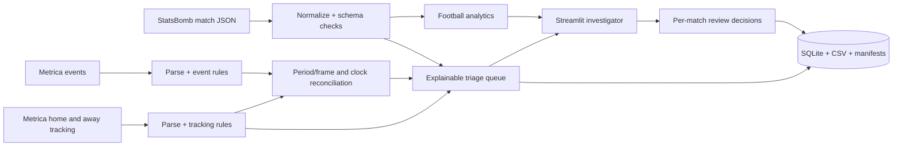

# Football Data Detective ⚽ | v6.1 (Tracking metadata and cross-feed audit fixes)

**An explainable football event and tracking-data quality system.** Import a StatsBomb match, reconcile synchronized Metrica events against tracked players and the ball, investigate flagged observations, and export documented SQL/CSV data products.

This is an independent portfolio project designed to demonstrate the type of analytical and engineering judgment used in football video-data workflows. It is **not affiliated with Veo**. Built with AI assistance, with separate validation, automated tests, and explicit limitations.

The standalone `demo_report.html` can be opened in Chrome or Edge after extracting the ZIP. It shows clearly labelled synthetic data.

> **Evidence level (v6.1):** 116 automated tests pass (three environment/network-dependent skips). The core package coverage is measured by `verify_release.py`; do not confuse coverage with real-data accuracy. Both offline pipelines have been verified. Full public-match downloads, complete Streamlit interactions and real-world error detection accuracy have **not** been verified here. This is an AI-assisted portfolio QA prototype, not a video-validated or production-grade system. See [v6 audit response](docs/INDEPENDENT_AUDIT_RESPONSE_V6.md) and [v6.1 release notes](RELEASE_NOTES.md).

## Changes after the independent v6 review (v6.1)

- Out-of-order tracking frames are flagged **within the same period**; a normal half-time frame reset is not flagged.
- Missing, nonnumeric, or non-finite frame/time/period cells are reported instead of silently preventing continuity validation.
- Home and away tracking exports are cross-checked at unique shared `(period, frame)` observations for clock and ball-position disagreement. The 2 m ball agreement threshold is **a configurable review heuristic**, not an empirically calibrated error classifier.
- Seven additional adversarial tests cover these behaviors. Full public Metrica processing and GUI interaction remain **unverified** here.

## Try it immediately

1. **No installation:** extract the ZIP and double-click [`demo_report.html`](demo_report.html) in Chrome/Edge to explore an interactive, offline HTML report with clearly labelled synthetic observations.
2. **Windows shortcut:** double-click `start_dashboard_windows.bat` after installing Python 3.11+. This automatically creates a local virtual environment, installs dependencies (internet required), and launches Streamlit. If Windows blocks the script, use the manual commands below.
3. **Full application** (Python 3.11+):

   ```bash
   python -m venv .venv
   # macOS/Linux: source .venv/bin/activate
   # Windows PowerShell: .venv\Scripts\Activate.ps1
   python -m pip install -r requirements.txt
   streamlit run app.py
   ```

4. **Verify core behavior with one command:**

   ```bash
   python verify_release.py
   ```

   This runs pytest, two independent offline data pipelines, a controlled corruption benchmark, and regenerates the HTML evidence report. Results are saved to `release_verification.json`. External downloads and the live Streamlit UI are separately disclosed as unverified.

### What to click first in the Streamlit app

Choose **StatsBomb · offline demo** for event QA, shots, passing networks, ranked issues, and a pitch-based event inspector. Choose **Metrica · offline demo** to view matching player and ball tracking, event-clock alignment, and review decisions. To save analyst judgments, click **Enable persistent reviews** in an investigator or **Build SQL data products** in the exports tab. Public data options download from the named repositories when you have internet access.

## What the system does

| Function | Implementation and caveat |
|---|---|
| Ingest | StatsBomb JSON and multirow-header Metrica tracking/event CSVs, with cached public download adapters |
| Structural event QA | Missing/duplicate event IDs, invalid coordinates, pass disagreement, malformed times, invalid xG; no arbitrary automatic corrections |
| Football analytics | Provider xG, shot maps, passing networks, two transparent pass-progression definitions, possession event outcomes and final-third entries (not a trained model) |
| Tracking QA | Separate human/ball thresholds, dropped or reversed frames, missing frame/time metadata, multi-frame missing detection runs, ambiguous frame suppression, period-aware continuity and pitch bounds |
| Event ↔ tracking | Metrica **(period, frame)** checks start/end clocks, initiating player and ball position, pass receiver; separate home/away exports are checked for shared ball and clock disagreements; contradictory duplicate frames are unverifiable |
| Investigation | Priority-ranked, human-readable queue; comparison overlays; event context; persistent SQL review statuses and notes |
| Data products | Staged per-match SQLite/CSV bundle publication, source-versioned review identities, SHA-256 provenance and reports |
| Evidence | 116 tests, independent hand-calculated football geometry cases, Python 3.11 grammar scan and real-source event excerpt; no claims of ground-truth real-match accuracy |

**Important:** StatsBomb and Metrica are independent sample matches, never incorrectly matched to each other. Metrica supplies synchronized **event + tracking**, not synchronized **video**. No footage is verified.

## Architecture



## Command-line data workflows

```bash
# Both of these run offline and use distinctly labelled synthetic fixtures
python pipeline.py statsbomb --demo --out output
python pipeline.py metrica --demo --out output

# Actual public datasets (downloads require internet)
python pipeline.py statsbomb --match-id 3788741 --out output
python pipeline.py metrica --game 1 --out output

# Local input files
python pipeline.py statsbomb --json path/to/events.json --out output
python pipeline.py metrica --events-file path/to/events.csv \
  --home-file path/to/tracking_home.csv \
  --away-file path/to/tracking_away.csv --out output
```

### Generate a standalone HTML report from other data

```bash
# Synthetic fixtures, completely offline
python demo_report.py --out demo_report.html

# A local StatsBomb-format events file; labels do not assume it is authentic
python demo_report.py --statsbomb-json path/to/events.json --out own_match.html

# Public StatsBomb match with a separate, clearly labelled synthetic Metrica fixture
python demo_report.py --statsbomb-match-id 3788741 --out statsbomb_report.html

# Public Metrica Game 1, with a separate synthetic StatsBomb event fixture
python demo_report.py --metrica-game 1 --out metrica_report.html
```

### Full public Metrica match verification (run on your Windows PC)

This creates a **real match case-study template** only after actually downloading the public tracking and event data. It does not silently substitute the synthetic fixtures.

```powershell
python verify_public_match.py --game 1
```

This operation has not been successfully run in the build environment due to blocked raw-data downloads. The report will appear in `real_match_output/metrica_1/PUBLIC_MATCH_VERIFICATION.md` together with source SHA-256 hashes, SQL/CSV files, and candidate cases for manual inspection. If direct downloads fail, download all three Metrica Game 1 raw CSV files separately and run:

```powershell
python verify_public_match.py --game 1 --events-file events.csv --home-file home.csv --away-file away.csv
```

**This public-match case study is not included as a completed verification in the ZIP**, because GitHub's raw-data host was inaccessible in the build environment. A serious technical portfolio should disclose that. No calculated QA precision or recall is claimed without independent expert labels.

For public data sources and citations, see [StatsBomb Open Data](https://github.com/hudl/open-data) and [Metrica Sports sample data](https://github.com/metrica-sports/sample-data).

## SQL products and data dictionary

Every processed match gets its **own database** under `output/<match_key>/football.sqlite`, CSV tables, a report and a provenance manifest. Re-running the same match preserves reviews; different uploaded StatsBomb files are assigned distinct hash-suffixed keys to avoid review collisions.

The `investigation_queue` table contains rule, priority, reason, observed/expected values, and an `event_key` that joins to the persistent `reviews` table. Priorities are **sorting heuristics**, *not* probabilities. `dataset_metrics` contains coverage and flag statistics, *not* a model quality score. See [`docs/DATA_DICTIONARY.md`](docs/DATA_DICTIONARY.md).

Example SQL:

```sql
SELECT rule, severity, COUNT(*) AS candidates
FROM investigation_queue
GROUP BY rule, severity
ORDER BY candidates DESC;

SELECT q.rule, q.priority, q.event_key, COALESCE(r.status, 'unreviewed') AS decision
FROM investigation_queue AS q
LEFT JOIN reviews AS r ON q.event_key = r.event_key
ORDER BY q.priority DESC LIMIT 20;
```

## Key QA decisions

- A speed threshold appropriate to a human player should **not** be applied to a football. Ball speed has its own rule.
- Reconciliation matches **both period and frame**, rather than trusting a frame number across periods.
- Event and tracking clocks get a separate `clock_alignment` check, so timing mismatches aren't disguised as spatial errors.
- When a tracked player or frame is unavailable, the result is `unverifiable`, **not** `consistent` and not `incorrect`.
- A shooting endpoint can naturally extend slightly outside the touchline, so event bounds checks allow a modest tolerance.
- Automated review candidates are hypotheses. The analyst can record `confirmed_issue`, `false_positive`, or `uncertain`, along with notes.

## Tests and limitations

```bash
python -m pytest -q --cov=fdd --cov-report=term-missing
```

The latest offline verification passed **109 tests**, with **3 skipped**, and **93% statement coverage in `fdd/`**. CI is configured to test on Python 3.11 and 3.13 with a 90% package-coverage minimum. This is not whole-app coverage or scientific model accuracy; Streamlit is not included in the percentage.

**Do not claim:** 95% real-match detection accuracy, production deployment, training a new xG model, recognized tactical formations, confirmed data-provider mistakes, synchronized video validation, or full Streamlit UI testing here. The controlled benchmark detected 35/35 deliberately injected defects under the exact expected rules; it measures *synthetic* checks, not field performance.

Before submitting the portfolio to an employer, run the Streamlit UI and one public-match data download locally. The current environment couldn't access the public file servers or install Streamlit. See [`docs/VERIFICATION.md`](docs/VERIFICATION.md), [`docs/CASE_STUDY.md`](docs/CASE_STUDY.md), and [`docs/INTERVIEW_GUIDE.md`](docs/INTERVIEW_GUIDE.md).

## Attribution

- **StatsBomb Open Data**. Public research or analysis based on their events should state the data source as StatsBomb and follow their logo/branding attribution terms.
- **Metrica Sports Sample Data**. Credit Metrica Sports when using their publicly supplied, anonymized sample events/tracking.
- Bundled offline fixture matches are entirely synthetic; the `examples/metrica_official_excerpt.csv` includes a small excerpt of actual public Metrica events for parser-compatibility testing.

MIT-licensed *project code*. Third-party football data retains its provider terms. No API keys, betting services, private sports video or private Veo data are required.


## Independent audit history

An independent assessment of v5 scored it 6.2/10 and identified serious QA and data-integrity problems, despite its high package test coverage. The v5.1 release fixed those faults; v6 also fixes the six additional issues found in the 7.2/10 re-audit and deepens event analysis. See [the audit response](docs/INDEPENDENT_AUDIT_RESPONSE.md) and the extended test suite. **Do not call the project a verified 9/10 or production-ready system.** It still needs a full genuine public-match audit, expert-reviewed error labels, and complete Streamlit integration testing.


## v6 audit improvements and caveats

The second outside review scored v5.1 at 7.2/10 and reproduced six further issues. This release fixes all six, adds independent regression tests and richer contextual football metrics. See [the issue-by-issue changelog](docs/INDEPENDENT_AUDIT_RESPONSE_V6.md). **An 8/10+ score remains a subjective target, not a guaranteed external assessment** until full public-match and Streamlit interaction verification are completed.
